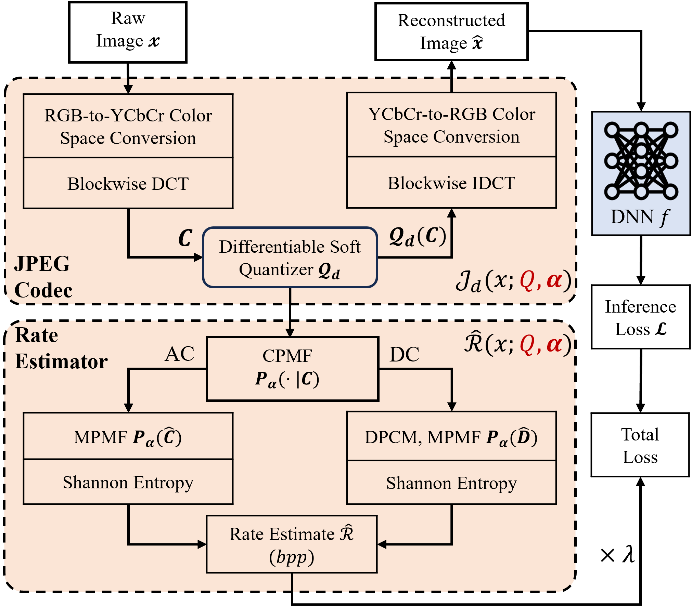
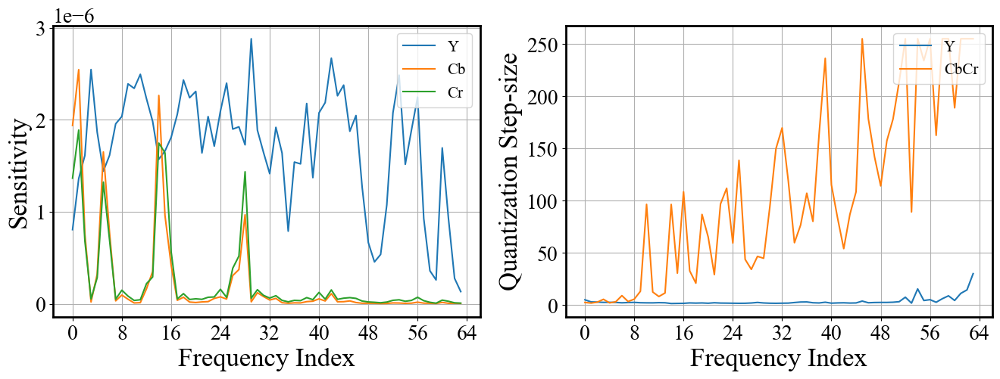
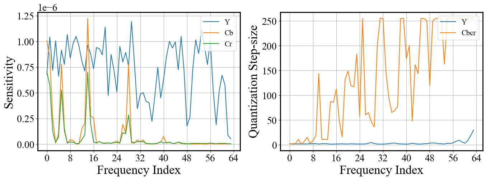
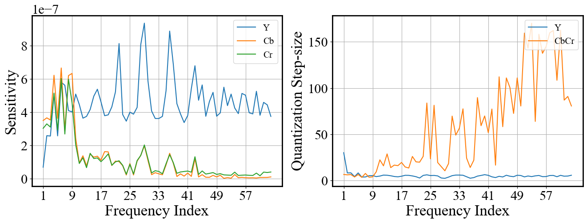
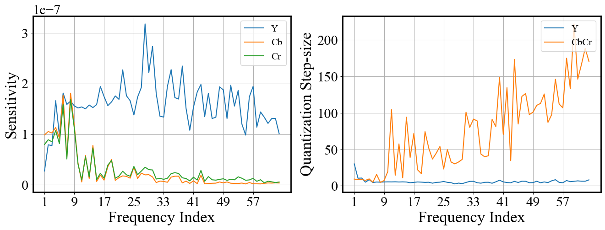
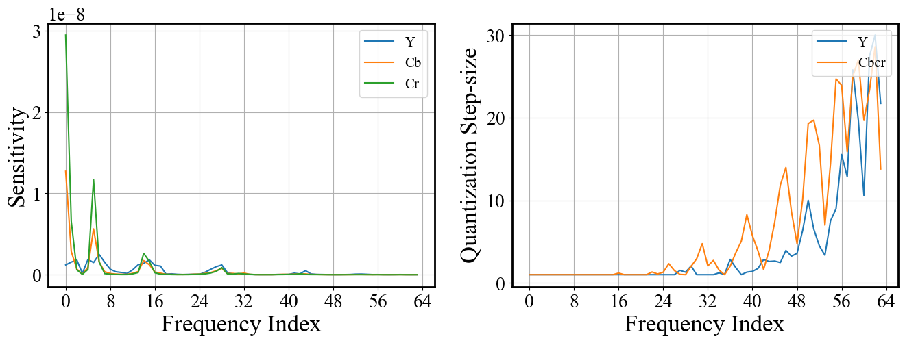
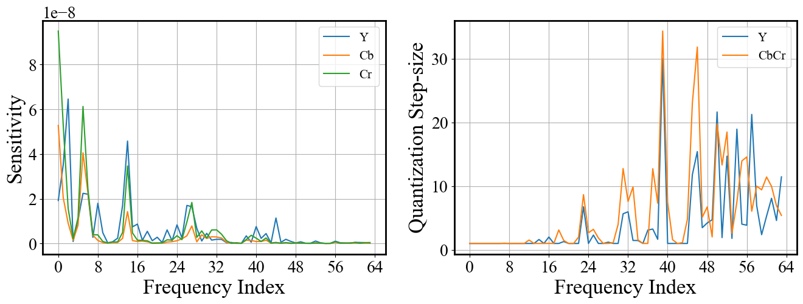
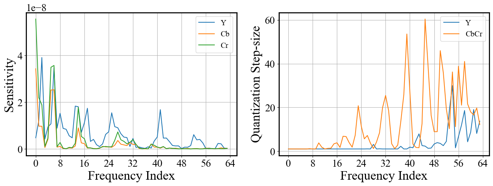

# Learned JPEG Compression for DNN Vision (J4D)
This zip file is for reproducing the experimental results in our paper [*Learned JPEG Compression for DNN Vision*] submitted at CVPR 2025.

<p align="center">

</p>


## Installation
The code is tested with Python 3.9, CUDA 11.7, and based on the `requirements.txt` or `requirements.yaml` files provided. The code also relies on the `rate_calc.so` and `HDQ.so` files for real rate calculation through run-length-encoding and Huffman coding during the testing stage using <i>Q<sub>p</sub></i> and <i>Q<sub>u</sub></i>, respectively.


## Differentiable JPEG Codec and Rate Estimator
The code for implementing differentiable JPEG codec and rate estimator can be found in [this file](./helper/JPEG_layer.py). 

To note that, since we use 11 bits to encompass all possible reconstruction levels, where L = 2<sup>b-1</sup> - 1 = 1023, it will have some computation overheads since the softmax operation in quantizers with $11$ bits is time-consuming. To address this issue, each CPMF is modified to be concentrated proportionally on the top five values with the rest of the conditional probabilities to be 0.

## Training J4D
For ImageNet training, please use [this bash file](./run_imagenet.sh).

Or use this command for QF-based initilization training: 
```
CUDA_VISIBLE_DEVICES=0,1,2,3 python3.9 -m torch.distributed.run --master_port=10427 --nnodes=1 --nproc_per_node=4 train_imagenet.py --JPEG_enable --freeze_model --fixed_alpha --QF_Inital \
                                    --dataset "imagenet" --model "model_name" --num_workers 64 \
                                    --data_path "your_dataset_path" \
                                    --epochs 20 --trial 1 --batch_size 64 \
                                    --JPEG_alpha 100  --JPEG_learning_rate 0.01 \
                                    --Q_initial_QF 10 --weight_lum 0.1 --weight_chrom 0.1 
```

Use this command for sensitivity-based initilization training: 
```
CUDA_VISIBLE_DEVICES=0,1,2,3 python3.9 -m torch.distributed.run --master_port=10427 -nnodes=1 --nproc_per_node=4 train_imagenet.py --JPEG_enable --freeze_model --fixed_alpha --Sensitivity_Inital \
                                --dataset "imagenet" --model "model_name" --num_workers 64 \
                                --data_path "your_dataset_path" \
                                --epochs 20 --trial 1 --batch_size 64 \
                                --JPEG_alpha 100  --JPEG_learning_rate 0.01 \
                                --Q_initial_Sensitivity 15 --weight_lum 0.01 --weight_chrom 0.01 \
                                --val_resize_size 232
```
Both will save the rate-accuracy (R-A) results and optimized qtables after each epoch to a corresponding folder under `./save/imagenet`.
Follow the `--val_resize_size` used for each model in [PyTorch](https://github.com/pytorch/vision/tree/main/references/classification#resnet). For example, for ConvNeXt_tiny, the `--val_resize_size` is 236 while for Swin_T it is 232.


### Sensitivity-Based Initialization of Quantization Tables
Based on the drived Senstivity, we have followed the following steps to initialize the Q-Tables for J4D. Here β refers to the constant scaling factor.
```
max_value = max(1/Y_sens)
q_y = β / (Y_sens · max_value)
q_cbcr = 2β / ((Cb_sens + Cr_sens) · max_value)
```

### The sensitivity plots for 4 DNN models on ImageNet and 3 DNN models on CUB-200-2011 are shown as follows, alongside their corresponding initialization
All those sentivitity values have been store under the correposing dataset and model folder under [this path](./save), with name `Y.npy`, `Cb.npy` and `Cr.npy`.

<div style="display: grid; grid-template-columns: 1fr 1fr; gap: 12px; justify-items: center;">
    <figure style="margin: 6px;">
        <figcaption style="font-size: larger;">ImageNet (MobileNetV2)</figcaption>
        
    </figure>
    <figure style="margin: 6px;">
        <figcaption style="font-size: larger;">ImageNet (MnasNet)</figcaption>
        
    </figure>
    <figure style="margin: 6px;">
        <figcaption style="font-size: larger;">ImageNet (Swin_T)</figcaption>
        
    </figure>
    <figure style="margin: 6px;">
        <figcaption style="font-size: larger;">ImageNet (ConvNeXt-tiny)</figcaption>
        
    </figure>
</div>

<div style="display: grid; grid-template-columns: 1fr 1fr; gap: 12px; justify-items: center;">
    <figure style="margin: 6px;">
        <figcaption style="font-size: larger;">CUB-200-2011 (ResNet18)</figcaption>
        
    </figure>
    <figure style="margin: 6px;">
        <figcaption style="font-size: larger;">CUB-200-2011 (MobileNetV2)</figcaption>
        
    </figure>
    <figure style="margin: 6px;">
        <figcaption style="font-size: larger;">CUB-200-2011 (MnasNet)</figcaption>
        
    </figure>
    <figure style="margin: 6px;"></figure>
</div>

## Acknowledgements
This repo is based on the code given in [PyTorch](https://github.com/pytorch/vision/tree/main/references/classification#resnet) for ImageNet.


<!-- ## Citation
```
    @inproceedings{
    anonymous2024learned,
    title={Learned JPEG Compression for DNN Vision},
    author={Anonymous},
    booktitle={Submitted to The Conference on Computer Vision and Pattern Recognition 2025},
    year={2024},
    url={https://openreview.net/forum?id=te2IdORabL},
    note={under review}
    }
``` -->